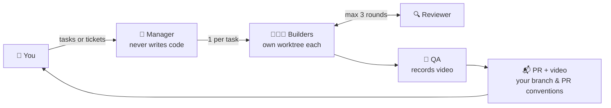

# agent-orchestra

A [Claude Code](https://claude.com/claude-code) plugin that runs a **manager agent** over many
**builder agents**, and turns tickets or plain-text tasks into **reviewed, tested pull requests
with a video of the change working**. It never merges; a human does.



- **Manager / builder split.** You talk to one manager. It splits work, allocates IDs, starts up to
  N builders and checks on them on a timer. It never touches code.
- **Test-first builders in isolated worktrees.** Each builder writes a failing test, implements,
  passes your `verify` commands, and loops with a reviewer at most three times.
- **Video proof on every PR, kept out of your repo.** QA records the feature working and attaches
  it with `gh --attach` to GitHub's attachment storage, falling back to a free R2/S3 bucket.
- **Your conventions, enforced.** Per-repo base branches, `AA-NNNN` IDs, `feat/AA-NNNN-slug`
  branches, one-line commits, required PR sections and no attribution. Hooks check every
  `git commit`, `git push` and `gh pr create`.
- **Never merges.** `gh pr merge` and pushes to base branches are blocked.
- **ADRs throughout.** The plugin's own design is recorded as [16 ADRs](docs/adr/README.md).
  Agents read them, draft new ones, and a hook blocks architecture changes that arrive without
  one.

## Quick start

```text
/plugin marketplace add arslan8122/agent-orchestra
/plugin install agent-orchestra@agent-orchestra
```

In your project:

```text
/orchestrate init            # asks: tickets or text tasks? PR convention? video host? builders?
```

```bash
ORCHESTRA_ROLE=manager claude --agent agent-orchestra:manager
```

```text
/orchestrate tasks
- API: GET /bids/:id/timeline returns status changes in order
- Web: show the timeline on the bid page
/loop 15m /orchestrate tick
```

You get one question at a time, then PR links, each with a video to watch before you merge.

## Requirements

Claude Code, git 2.40+, **gh 2.99+** (for `--attach`), python3, ffmpeg, and Playwright for UI
videos. A ticket MCP server is needed only in ticket mode.

## Docs

- **[Setup and usage guide](docs/guide.md)**: everything from install to daily use, with diagrams.
- **[Architecture Decision Records](docs/adr/README.md)**: why it works the way it does.
- [Example config](templates/orchestra.example.json) · [PR body template](templates/pr-body.md)

## Status

`v0.1.0`, phase 1. The agents, commands, hooks, scripts and templates are in place, and
`bash tests/run.sh` passes (27 checks). It hasn't yet been piloted end to end on a real project;
see the [rollout plan](docs/guide.md#13-rollout-plan).

## Credits

The manager/builder/reviewer/QA structure is inspired by Ryan Carson's talk *"One Founder. 20 AI
Coding Agents. All Working at Once!"* at AI Engineer New York (October 2026). The ADR format
follows [Michael Nygard](https://cognitect.com/blog/2011/11/15/documenting-architecture-decisions)
and [Martin Fowler](https://martinfowler.com/bliki/ArchitectureDecisionRecord.html).

## License

[MIT](LICENSE)
