# agent-orchestra: setup and usage guide

A Claude Code plugin that runs one **manager agent** over many **builder agents**. Each builder
takes one task, builds it test-first, loops with a reviewer, gets a QA agent to record a video of
the working feature, and **opens a pull request with that video attached**. The system never
merges: a human reviews and merges every PR in GitHub. Architecture Decision Records (ADRs)
capture every decision along the way.

It works against any repo; each project supplies one `.orchestra.json`.

Inspired by Ryan Carson's talk *"One Founder. 20 AI Coding Agents. All Working at Once!"*
(AI Engineer New York, 2026-10-14), adapted in three ways: it stops at an open PR instead of
merging, it accepts plain-text tasks as well as tickets, and it follows your team's existing
branch and PR conventions.

---

## Contents

1. [The model](#1-the-model)
2. [Rules the system enforces](#2-rules-the-system-enforces)
3. [Repository layout](#3-repository-layout)
4. [Setup](#4-setup)
5. [Using it day to day](#5-using-it-day-to-day)
6. [A task's lifecycle](#6-a-tasks-lifecycle)
7. [Branch and PR conventions](#7-branch-and-pr-conventions)
8. [Video proof in the PR](#8-video-proof-in-the-pr)
9. [Scaling to a team](#9-scaling-to-a-team)
10. [ADRs throughout](#10-adrs-throughout)
11. [Plugin internals](#11-plugin-internals)
12. [Troubleshooting](#12-troubleshooting)
13. [Rollout plan](#13-rollout-plan)

---

## 1. The model

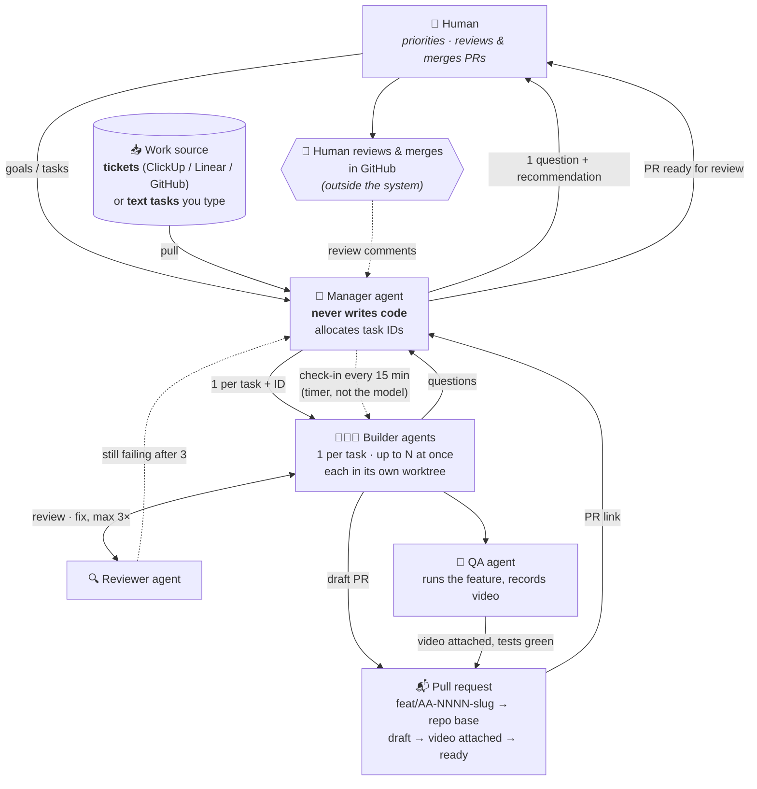

You give the manager work: ticket IDs, or one or more plain-text tasks. The manager allocates each
task an ID (`AA-0031`) and starts one builder per task. Builders write a failing test first, build
the feature, loop with a reviewer at most three times, and open a **draft** PR. A QA agent runs the
feature, records a video, attaches it to the PR and takes the PR out of draft. You watch the video
and review in GitHub, then merge. If you leave review comments, the manager sees them on its next
check-in and sends the builder back to work.

---

## 2. Rules the system enforces

Each rule is enforced by a mechanism, not just stated in a prompt, and each has an ADR
(see [`docs/adr/`](adr/README.md)).

| Rule | Enforced by | ADR |
|---|---|---|
| No task, no work | Builders start only from a ticket or a recorded text task | 0002 |
| Manager never writes code | Manager has no Edit tool; `manager_no_write.py` blocks Write outside `.orchestra/`; `pr_guard.py` blocks the manager's `git commit/push` | 0003 |
| Humans never talk to builders | Builders are started by the manager; their questions route back to it | 0004 |
| Supervision runs on a timer | `/loop 15m /orchestrate tick` | 0005 |
| Max 3 review rounds | Round counter in `.orchestra/state/<ID>.json`; round 4 escalates | 0006 |
| Done means verified | `verify` commands must pass; the failing test comes first | 0007 |
| Every PR carries video proof | PR opens as draft with a Demo placeholder; `gh pr ready` is blocked until the video is attached | 0008 |
| **The system never merges** | `pr_guard.py` blocks `gh pr merge` and pushes to base branches; branch protection backs it | 0009 |
| One allocator for task IDs | `scripts/allocate-number.sh`, per repo, under a lock | 0010 |
| Work source is chosen at setup | `work.source`: `text` or `tickets` | 0013 |
| Videos stay out of the repo | `gh --attach` to GitHub's attachment storage; S3-compatible bucket fallback | 0014 |
| PRs follow the project's convention | `pr_guard.py` checks base, branch name, commit subject, body sections, attribution | 0015 |

---

## 3. Repository layout

```mermaid
flowchart LR
    subgraph P["agent-orchestra (this plugin)"]
        direction TB
        P1[".claude-plugin/<br/>plugin.json · marketplace.json"]
        P2["agents/<br/>manager · builder · reviewer · qa"]
        P3["commands/<br/>orchestrate · adr"]
        P4["hooks/<br/>hooks.json + python guards"]
        P5["scripts/<br/>allocate-number · upload-proof"]
        P6["templates/<br/>config · pr-body · brief · task · adr"]
        P7["docs/<br/>guide.md · adr/"]
    end
    subgraph X["your project"]
        direction TB
        X1[".orchestra.json"]
        X2["docs/adr/"]
        X3[".orchestra/ (gitignored)<br/>tasks · state · claims · locks"]
        X4["CLAUDE.md → ADR section"]
    end
    P -- "/plugin install" --> X
```

```text
agent-orchestra/
├── .claude-plugin/{plugin.json, marketplace.json}
├── agents/{manager, builder, reviewer, qa}.md
├── commands/{orchestrate, adr}.md
├── hooks/{hooks.json, _common.py, manager_no_write.py, pr_guard.py, adr_guard.py}
├── scripts/{allocate-number.sh, upload-proof.sh}
├── templates/{orchestra.example.json, pr-body.md, builder-brief.md, task.md, adr.md, claude-md-section.md}
├── docs/{guide.md, adr/0001…0016 + README.md}
└── tests/run.sh
```

---

## 4. Setup

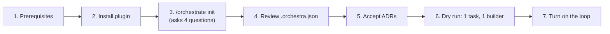

### 4.1 Prerequisites

| Need | Why | Check |
|---|---|---|
| Claude Code (recent) | plugins, sub-agents, `/loop` | `claude --version` |
| `git` 2.40+ | worktrees | `git worktree list` |
| `gh` **2.99+**, authenticated | PRs; `--attach` for videos | `gh --version`, `gh auth status` |
| `python3` | hooks (standard library only) | `python3 --version` |
| `ffmpeg` | re-encode the video under 10 MB | `ffmpeg -version` |
| Playwright (UI repos) | records the video | `npx playwright --version` |
| Ticket MCP server (ticket mode only) | ClickUp / Linear / GitHub Issues | `/mcp` |
| A `verify` command that catches bugs | everything depends on it | run it on a known-broken commit; it must fail |

**GitHub (once per repo):** protect each base branch (require a PR and an approval, block direct
pushes). That backs ADR-0009: even if a hook failed, an agent couldn't merge.

### 4.2 Install

```text
/plugin marketplace add arslan8122/agent-orchestra
/plugin install agent-orchestra@agent-orchestra
```

Or, while developing the plugin itself:

```bash
claude --plugin-dir /path/to/agent-orchestra
```

### 4.3 Initialise the project

```text
/orchestrate init
```

Init detects the stack (package files, docker-compose, `.gitmodules`, Playwright, an existing PR
command), then asks four questions before writing anything:

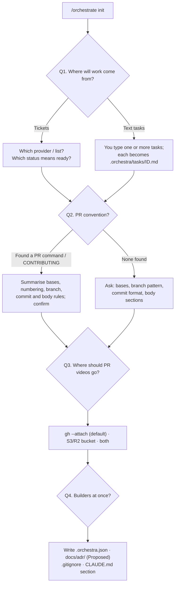

```text
> /orchestrate init

Detected: 3 repos (services/api, apps/web, docs-site), docker-compose, Playwright in apps/web,
          .claude/commands/open-pr.md

Q1. Where will work come from?
    1) Tickets from a board   2) Text tasks I type (one or many)
> 2

Q2. I read .claude/commands/open-pr.md:
    • IDs:     AA-NNNN, separate counter per repo, next = highest in `git branch -a` + 1
    • branch:  feat/AA-NNNN-<2–5 word slug>  (fix/ for repairs; docs/ in docs-site)
    • bases:   api → development · web → development · docs-site → main
    • commit:  one line, `feat(<scope>): …`, no body, no attribution
    • PR body: Problem · Change · Deliberately not done · Verification · Demo · Paired with
    Correct?
> yes

Q3. Where should PR videos go?
    1) GitHub attachment via gh --attach (free, not in the repo)   2) S3/R2 bucket   3) Both
> 3

Q4. Builders at once?  1 / 3 (recommended) / 5
> 3

Wrote .orchestra.json, docs/adr/0001–0016 (Proposed), .gitignore, CLAUDE.md section.
gh 2.99.0 ✓  ffmpeg ✓  verify: 2/2 commands pass.
Next: review .orchestra.json, run /adr list, then a dry run.
```

### 4.4 The project config

`.orchestra.json` (committed). Full example: [`templates/orchestra.example.json`](../templates/orchestra.example.json).

| Key | Meaning |
|---|---|
| `work.source` | `text` or `tickets` (Q1) |
| `work.tickets` | provider, list, ready status, whether to link the ticket in the PR |
| `repos.<name>` | `path` (relative to the config), `base` branch, optional `branch_type` override (e.g. `docs`). **A repo missing here → agents stop and ask; they never default to `main`.** |
| `verify` | commands that must exit 0 before a builder says done; run exactly as written |
| `pr.numbering` | `prefix` (`AA`), `digits` (4); counters are per repo |
| `pr.branch` | `pattern` (`{type}/{id}-{slug}`), allowed `types` |
| `pr.commit.pattern` | regex every commit subject must match; one line, no body |
| `pr.attribution` | `none`: no Co-Authored-By, no "Generated with" |
| `pr.body.sections` | headings the PR body must contain |
| `proof.record` | command that records the video (`{id}` is substituted) |
| `proof.host` / `proof.fallback` | `gh-attach`; fallback `s3` bucket, endpoint, public URL |
| `builders` | `max`, `isolation` (`worktree`), `review_rounds_max` |
| `supervision.tick` | how often `/orchestrate tick` runs |
| `adr.dir` / `adr.guard_paths` | where ADRs live; paths whose change requires an ADR |

### 4.5 Accept the starting ADRs

```text
/adr list
/adr accept 0001
```

Edit each Proposed ADR's Context for your project first. Accepted ADRs are never edited, only
superseded (§10).

### 4.6 Dry run

With `builders.max` set to 1:

```text
/orchestrate tasks "Add a GET /health endpoint to the api that reports database status"
```

Watch it end to end:
1. An ID is allocated (`AA-0018` in `api`).
2. The worktree and branch `feat/AA-0018-health-db-endpoint` are created from `origin/development` and pushed.
3. A failing test is written, then `verify` passes.
4. The review rounds are counted.
5. A draft PR opens.
6. QA attaches the video.
7. The PR comes out of draft.

### 4.7 Turn on supervision

Start the manager with its role set, so the guards know who is who:

```bash
ORCHESTRA_ROLE=manager claude --agent agent-orchestra:manager
```

```text
/loop 15m /orchestrate tick
```

---

## 5. Using it day to day

### 5.1 Giving it work

**Text mode.** One task or several in one message:

```text
/orchestrate tasks "Inbox: show the contractor's reply time in the list"
```

```text
/orchestrate tasks
- Inbox: show the contractor's reply time in the list
- Calendar: accepted bids appear as visits in week view
- API: GET /bids/:id/timeline returns status changes in order
```

The manager:
1. Splits the message into tasks and picks a repo for each.
2. Asks at most one question per ambiguous task, each with a recommendation.
3. Shows you the list.
4. After you approve, allocates IDs and writes `.orchestra/tasks/<ID>.md` for each.

A task spanning two repos becomes two task records with two IDs, one from each repo's counter.
Their PRs reference each other under *Paired with* (§7.4).

**Ticket mode:**

```text
/orchestrate build CU-1240 CU-1241     # specific tickets
/orchestrate build                     # everything in the ready status
```

### 5.2 Your daily loop

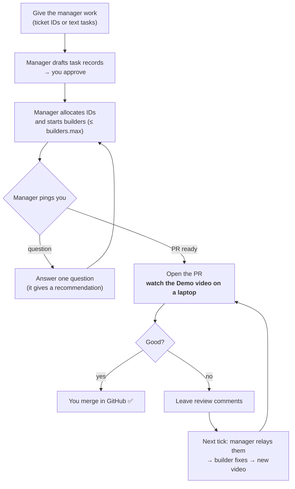

### 5.3 Commands

| Command | Who | What it does |
|---|---|---|
| `/orchestrate init` | you, once | Ask the 4 setup questions, write config, seed ADRs |
| `/orchestrate tasks "<text>"` | you (text mode) | One or more text tasks → task records for approval → builders |
| `/orchestrate build [ticket…]` | you (ticket mode) | Start builders for given or ready tickets |
| `/orchestrate plan "<goal>"` | you | Break a goal into tasks with dependencies; no builders yet |
| `/orchestrate tick` | the loop | Check builders, relay PR comments, start new builders |
| `/orchestrate status` | you | ID · repo · stage · rounds · PR · blocker |
| `/adr "<title>"` | anyone | Draft a Proposed ADR |
| `/adr list` / `accept` / `reject` / `supersede` | you | Manage ADRs |

There's no merge command. Merging happens in GitHub, by a person.

### 5.4 Talking to the manager

- "What needs me?" gets you one question at a time, each with a recommendation.
- "Pause everything touching auth." makes it hold those builders.
- "Why is AA-0031 stuck?" gets you the last check-in and the blocker.
- "I left comments on the web PR." makes it pick them up now instead of waiting for the next tick.

Don't open a builder's session to fix something yourself. Tell the manager or comment on the PR.

---

## 6. A task's lifecycle

### 6.1 State machine

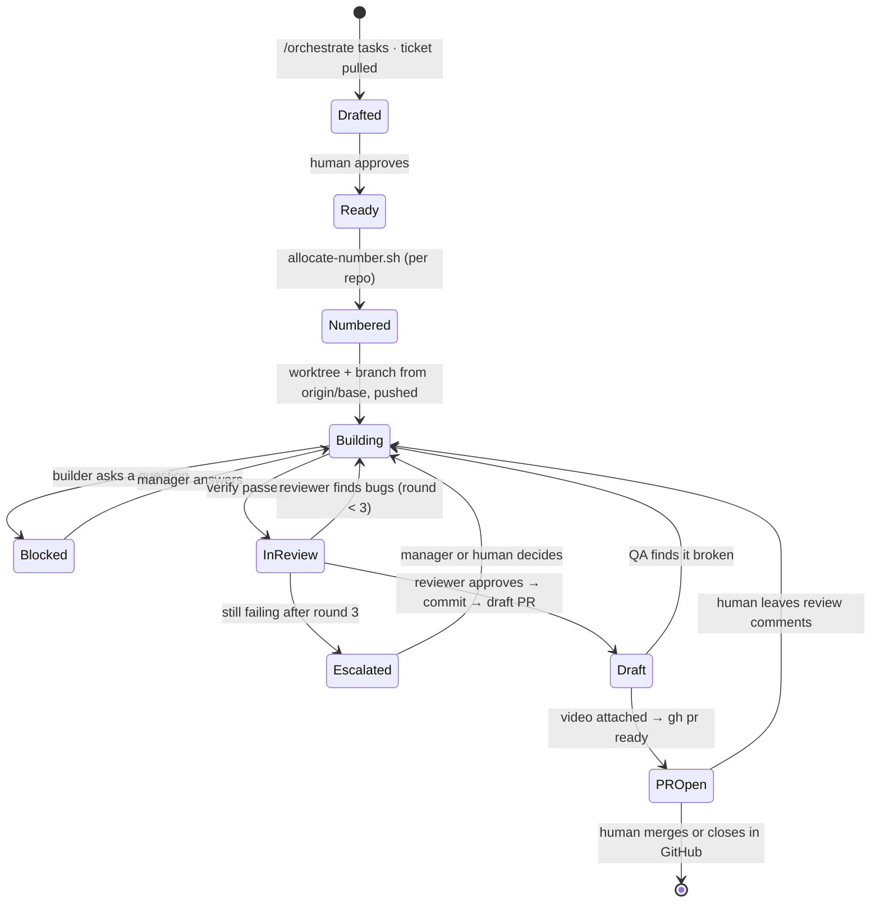

The system's responsibility ends at **PROpen**. Merging and closing are human actions it only
observes.

### 6.2 Sequence for one task

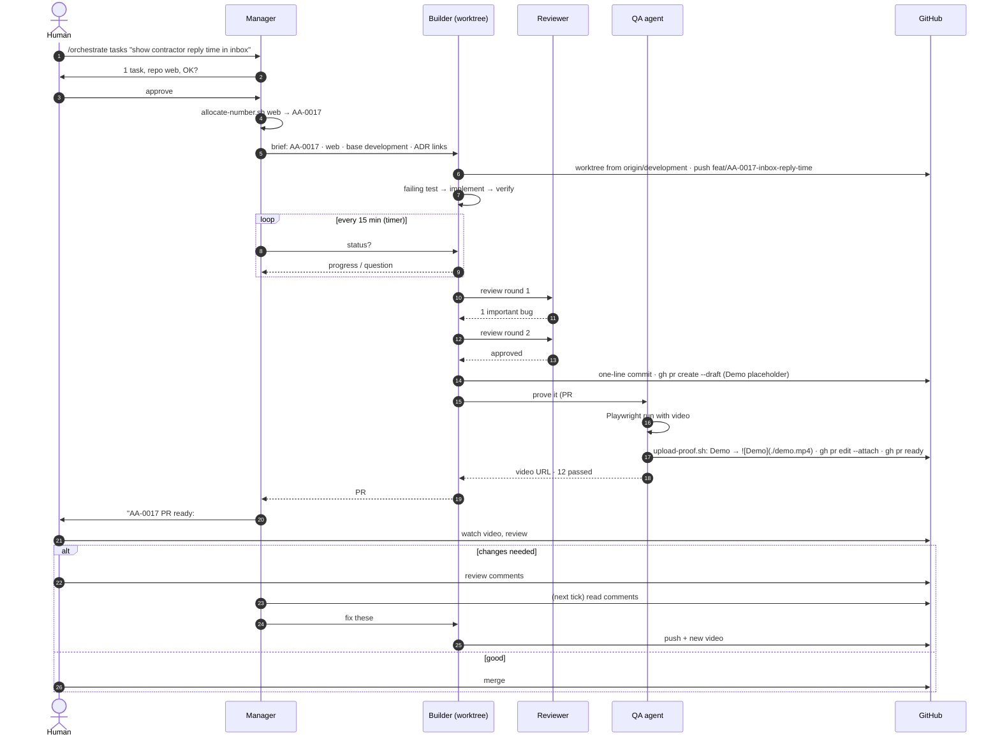

### 6.3 Builder internals

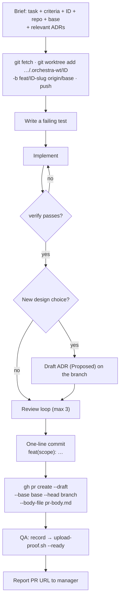

---

## 7. Branch and PR conventions

Builders follow the same rules a person on your team follows. `init` reads them from your PR
command or CONTRIBUTING file into `.orchestra.json`; `pr_guard.py` enforces them. The defaults
below come from a real team's `/open-pr` command.

### 7.1 IDs: `PREFIX-NNNN`, per repo, one allocator

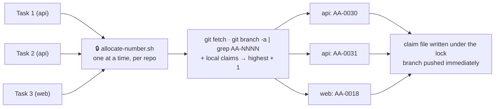

- **Each repo has its own counter.** A number is never carried across repos.
- **`git branch -a`, not just local branches.** A teammate's pushed branch has already claimed its
  number.
- **The allocator runs under a lock and writes a claim before releasing it.** So two tasks
  allocated seconds apart, before either branch is pushed, still get different numbers.
- **A repo with no matching branches** starts at `0001` only if the scan looks healthy (it has a
  remote and has branches). Otherwise the script refuses, because the scan is broken.

### 7.2 Branches and bases

| Rule | Default |
|---|---|
| Pattern | `feat/AA-NNNN-<slug>`; `fix/` when only repairing existing behaviour |
| Slug | 2–5 kebab-case words describing the change (`account-purge-endpoint`, not `changes`) |
| Per-repo prefix | `branch_type` in `repos.<name>` (e.g. `docs/` for a docs repo) |
| Base | `repos.<name>.base`; missing → stop and ask |
| Branch from | always `origin/<base>`, never the current HEAD (submodule HEADs are often stale) |

### 7.3 Commits and the PR

- **Commits:** one line in the configured format (`feat(api): add bid timeline endpoint`). No body,
  no trailers, no attribution. The builder stages only its own task's files, and its worktree holds
  nothing else.
- **The PR opens as a draft:**
  `gh pr create --draft --base <base> --head <branch> --title "<subject>" --body-file <file>`.
  Both `--base` and `--head` are required, which prevents "No commits between <base> and <branch>".
- **Body:** [`templates/pr-body.md`](../templates/pr-body.md), with every configured section filled.
  The Demo section starts as `<!-- orchestra:demo pending -->`.
- **Out of draft only after the video is attached** (§8).

### 7.4 Tasks that span repos

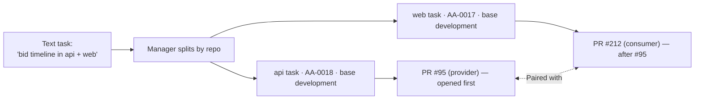

One PR per repo, each with its own ID and base. They're opened in dependency order (provider
first), and each one names the other under *Paired with*, saying what breaks if they merge apart.
The manager tells you which to merge first.

---

## 8. Video proof in the PR

Every PR carries a video of the change working (ADR-0008), and the video is **never stored in the
repo** (ADR-0014).

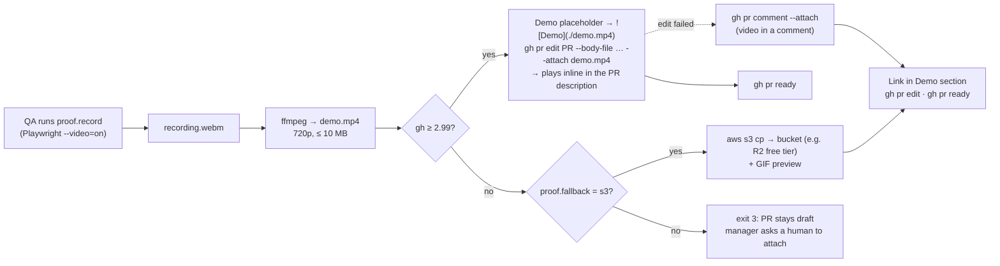

**Free hosting options, compared:**

| Option | Where the file lives | In the PR | Notes |
|---|---|---|---|
| **`gh pr edit --attach`** (default) | GitHub's attachment storage (`user-attachments`), not git | Video player inline in the PR description's Demo section | Free. Inherits repo visibility. Needs gh 2.99+. 10 MB video limit on free plans |
| **Cloudflare R2** (fallback) | Your bucket | GIF preview linking to the mp4 | Free tier: 10 GB storage, free egress. Links are unguessable, not access-controlled; set a lifecycle rule to delete after 90 days |
| Backblaze B2 | Your bucket | GIF + link | 10 GB free; egress free up to 3× stored data |
| Orphan media branch | Inside the repo | GIF + link | Avoid: grows every clone |
| YouTube unlisted | YouTube | Thumbnail link | Avoid: OAuth, quotas, anyone with the link can watch |

Back-end changes get a video too: QA records a terminal session running the tests plus one real
request and response. If you'd rather exempt them, supersede ADR-0008 instead of quietly skipping
it.

`gh` rewrites a reference already in the body (``) to the uploaded file, which
is how the video lands inside the Demo section rather than at the end. After a fix requested in
review, QA attaches a **new** video and moves the previous one under a "Previous" line in Demo.

---

## 9. Scaling to a team

Each person runs their own manager (sometimes two). Managers know each other's names and message
each other to unblock shared work. There's no merge manager, because humans merge. The only shared
resource left is each repo's ID counter, and the allocator's claims and lock handle it.

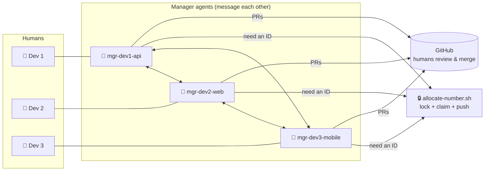

Naming (ADR-0011): `mgr-<human>-<area>`, `bld-<ID>-<repo>`.

> Allocation locks are per machine. Several people on different machines are kept apart by the
> rule that a builder pushes its branch immediately after allocating. The small remaining race
> (two machines allocating in the same second) shows up as a rejected push, and the builder
> re-allocates.

| Collision | Prevented by |
|---|---|
| Two branches claim the same ID | Lock + claim file + immediate push |
| PR from a stale submodule HEAD deletes merged work | Always branch from `origin/<base>` |
| PR against the wrong base | `repos.<name>.base`, checked by `pr_guard` |
| Cross-repo PRs merged out of order | *Paired with* in both bodies; manager states the order |
| Migration name clashes | Builder rebases on `origin/<base>` before opening; reviewer flags duplicate migration names |

---

## 10. ADRs throughout

ADRs (see [Martin Fowler](https://martinfowler.com/bliki/ArchitectureDecisionRecord.html)) are
short, numbered, immutable records of one decision each. Agents both **read** and **write** them.

### 10.1 Lifecycle

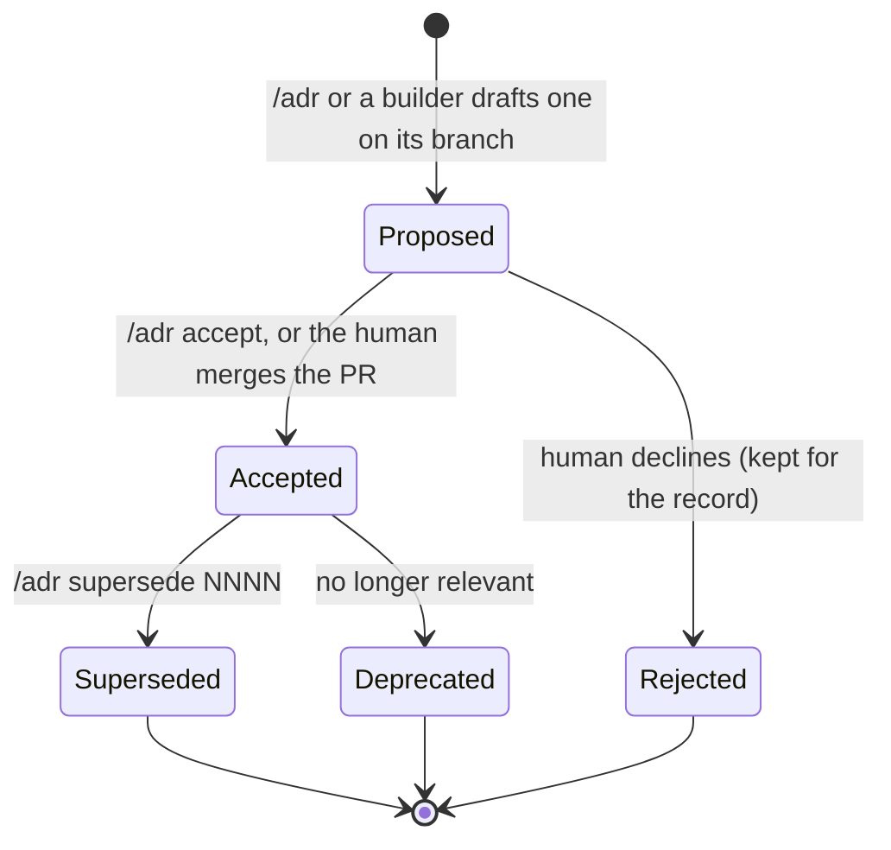

ADR numbers (`ADR-0001`) are separate from task IDs (`AA-0001`).

### 10.2 Where ADRs show up

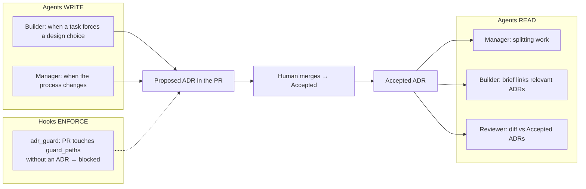

### 10.3 The starting set

These are the plugin's own decisions ([`docs/adr/`](adr/README.md)). `init` copies them into
your project as **Proposed**:

| ADR | Decision |
|---|---|
| 0001 | Record architecture decisions |
| 0002 | No task, no work; one task = one branch = one PR = one builder |
| 0003 | The manager agent never writes code |
| 0004 | Builders run isolated in their own worktrees; humans never address them |
| 0005 | Supervision runs on a timer |
| 0006 | Review loops are capped at three rounds |
| 0007 | Definition of done: failing test first, verify green, QA video |
| 0008 | Every PR includes a video of the change working |
| 0009 | The system opens PRs and never merges |
| 0010 | One allocator assigns task numbers per repo under a lock |
| 0011 | Session naming and manager-to-manager messaging |
| 0012 | Escalations are one question plus a recommendation |
| 0013 | Work comes from tickets or text tasks, chosen at setup |
| 0014 | PR videos are hosted outside the repo: gh --attach first, bucket fallback |
| 0015 | Agents follow the project's existing branch, commit and PR conventions |
| 0016 | Config is JSON and hooks use only the Python standard library |

`init` also appends [`templates/claude-md-section.md`](../templates/claude-md-section.md) to your
CLAUDE.md, so every agent session knows the ADR rules.

---

## 11. Plugin internals

### 11.1 Agents

| Agent | Tools | Job |
|---|---|---|
| `manager` | Read, Grep, Glob, Bash, Write (`.orchestra/` only), Agent, SendMessage, ListAgents, AskUserQuestion | Intake, IDs, start/supervise builders, relay comments, escalate |
| `builder` | Read, Edit, Write, Grep, Glob, Bash, Agent, SendMessage | One task: worktree, test-first, review loop, commit, draft PR, QA |
| `reviewer` | Read, Grep, Glob, Bash | Findings only: bugs, test gaps, ADR conflicts |
| `qa` | Read, Grep, Glob, Bash | Record video, check it shows the criteria, attach it, mark ready |

### 11.2 Hooks

`hooks/hooks.json` registers three PreToolUse hooks. They're active only in sessions started with
`ORCHESTRA_ROLE` set and only where a `.orchestra.json` exists, so a person's ordinary Claude Code
session in the same repo is unaffected.

| Hook | Blocks (exit 2) | ADR |
|---|---|---|
| `manager_no_write.py` | Edit/Write from the manager's own session outside `.orchestra/` (sub-agent calls carry `agent_id` and are allowed) | 0003 |
| `pr_guard.py` | `gh pr merge`; `git push` to any base branch; manager `git commit/push/merge/rebase` | 0009, 0003 |
| | `gh pr create` without `--base`/`--head`, wrong base, bad branch name, missing body section, attribution, empty Demo | 0015, 0008 |
| | `gh pr ready` while the Demo placeholder is still there | 0008 |
| | `git commit` with a body, a second `-m`, attribution, or a subject that doesn't match | 0015 |
| `adr_guard.py` | `gh pr create` when the diff touches `adr.guard_paths` without adding an ADR (opt out with "No ADR needed: <reason>") | 0001 |

`tests/run.sh` covers every row above plus the allocator. Run it after changing a hook.

### 11.3 State on disk (project's `.orchestra/`, gitignored)

```text
.orchestra/
├── tasks/AA-0017.md        # text-mode task record
├── state/AA-0017.json      # live state, one per task
├── claims/web/AA-0017      # allocator claim (timestamp)
└── locks/                  # allocator locks
```

```json
{
  "id": "AA-0017",
  "repo": "web",
  "source": "text",
  "ticket": null,
  "base": "development",
  "branch": "feat/AA-0017-inbox-reply-time",
  "worktree": "../.orchestra-wt/AA-0017",
  "builder": "bld-AA-0017-web",
  "stage": "PROpen",
  "review_rounds": 2,
  "pr": 212,
  "proof": "inline in PR #212 description",
  "paired_with": [],
  "last_tick": "2026-11-19T10:45:00Z",
  "last_seen_comment_id": null,
  "blocker": null
}
```

### 11.4 How a tick works

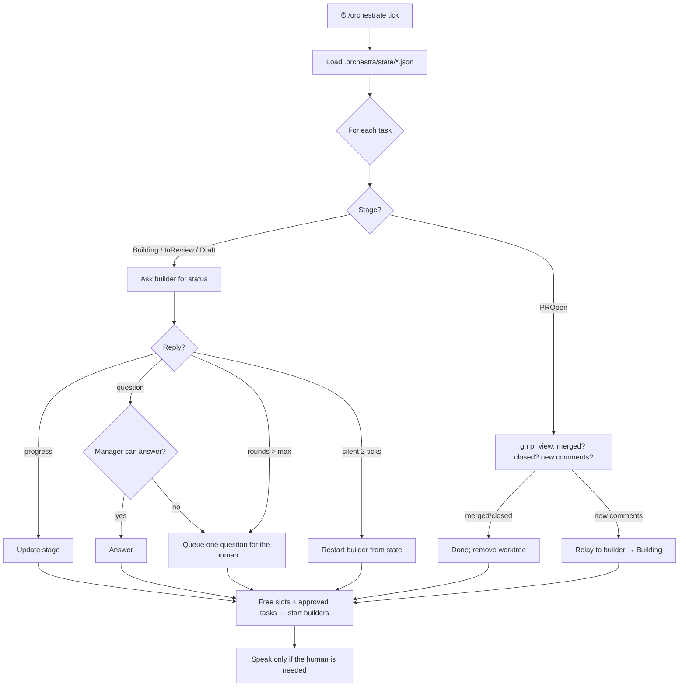

---

## 12. Troubleshooting

| Symptom | Likely cause | Fix |
|---|---|---|
| Guards never fire | Session started without `ORCHESTRA_ROLE`, or no `.orchestra.json` above the cwd | Start as in §4.7 |
| Builder edits blocked as "manager" | Your Claude Code version doesn't send `agent_id` for sub-agent calls | Check with a debug hook; report it (ADR-0003 consequence) |
| Two PRs with the same ID | Allocated outside the script, or on two machines in the same second | Only the manager allocates; re-allocate on a rejected push |
| PR deletes thousands of lines it didn't touch | Branched from a stale HEAD | Builders branch from `origin/<base>`; close and recreate |
| "No commits between base and branch" | Pushed one branch name, opened another | `--head` is required; check the names match |
| PR stuck in draft | Video upload failed (exit 3) | `gh --version` ≥ 2.99, or configure `proof.fallback`; or attach by hand and remove the placeholder |
| Video over 10 MB | Long recording | Shorter test (`--grep {id}`), or GitHub paid plan (100 MB) |
| Everything green but broken | `verify` too weak | Strengthen it; ADR-0007 is only as good as this |
| Builders collide on ports or the database | Worktrees share one local stack | Lower `builders.max`, or a compose project per worktree |
| Review comments ignored | Tick not running | Restart `/loop`; or tell the manager "check PR #N" |
| PRs pile up unreviewed | More builders than you can review | Lower `builders.max`; you're the bottleneck by design |

---

## 13. Rollout plan

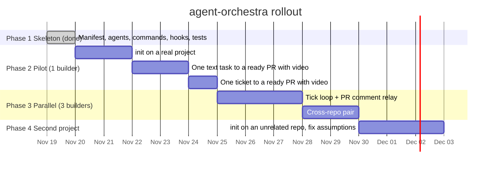

**Exit criteria**

1. **Skeleton:** `tests/run.sh` passes; the plugin loads with `--plugin-dir`.
2. **Pilot:**
   - A text task and a ticket each end as a ready PR.
   - Each PR has the correct ID, branch and base, a one-line commit, every body section, and a
     video that plays inline.
   - Nothing was merged.
3. **Parallel:**
   - Three builders run at once, two of them in the same repo, with distinct IDs.
   - A review comment is fixed with a new video within two ticks.
   - A cross-repo pair opens in dependency order.
4. **Second project:** `init` on an unrelated repo needs only the four answers. No plugin changes.
